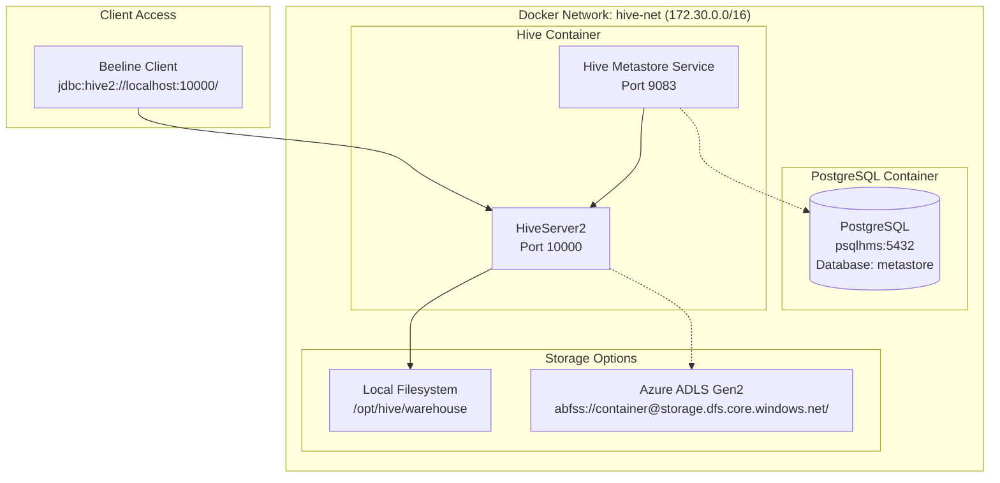

# Minimal Hive Setup with Docker Compose

A simplified, production-ready Hive environment with PostgreSQL metastore and local filesystem warehouse. This setup removes Spark completely while maintaining full Hive functionality for table creation and querying via Beeline.

## 🏗️ Architecture Overview



## 🚀 Quick Start

### Prerequisites

- Docker and Docker Compose installed
- At least 4GB RAM available
- Ports 9083, 10000, and 5432 available

### 1. Build and Run

```bash
# Clone the repository
git clone <your-repo-url>
cd hadoop3_spark_312

# Build and start services
./build-minimal.sh --run

# Or step by step:
./build-minimal.sh --build
docker-compose -f docker-compose-minimal.yml up -d
```

### 2. Connect with Beeline

```bash
# Connect to HiveServer2
docker exec -it hive-server beeline -u "jdbc:hive2://localhost:10000/"

# Or from host machine (if you have Beeline installed)
beeline -u "jdbc:hive2://localhost:10000/"
```

### 3. Test Hive Functionality

```sql
-- Create a test database
CREATE DATABASE test_db;
USE test_db;

-- Create a test table
CREATE TABLE employees (
    id INT,
    name STRING,
    department STRING,
    salary DOUBLE
);

-- Insert test data
INSERT INTO employees VALUES 
    (1, 'John Doe', 'Engineering', 75000.0),
    (2, 'Jane Smith', 'Marketing', 65000.0),
    (3, 'Bob Johnson', 'Sales', 55000.0);

-- Query data
SELECT * FROM employees;
SELECT department, AVG(salary) as avg_salary 
FROM employees 
GROUP BY department;

-- Show table location
DESCRIBE FORMATTED employees;
```

## 📁 Project Structure

```
hadoop3_spark_312/
├── hive-minimal/
│   ├── Dockerfile                    # Minimal Hive container
│   └── scripts/
│       └── start-hive-services.sh    # Service startup script
├── hadoop_config/
│   ├── hive-site-minimal.xml         # Hive configuration with Azure support
│   ├── core-site-minimal.xml         # Minimal Hadoop configuration
│   ├── hive-schema-2.3.0.postgres.sql
│   ├── hive-txn-schema-2.3.0.postgres.sql
│   └── init-hive-db.sh              # PostgreSQL initialization
├── postgres-hms/
│   └── Dockerfile                    # PostgreSQL metastore container
├── docker-compose-minimal.yml       # Simplified Docker Compose
├── build-minimal.sh                 # Build and deployment script
├── AZURE_ADLS_SETUP.md              # Azure configuration guide
└── README-MINIMAL-HIVE.md           # This file
```

## 🔧 Configuration

### Default Configuration (Local Filesystem)

- **Warehouse Directory**: `/opt/hive/warehouse` (mounted as Docker volume)
- **Metastore Database**: PostgreSQL at `psqlhms:5432`
- **HiveServer2 Port**: `10000`
- **Metastore Service Port**: `9083`

### Azure ADLS Configuration

For cloud storage with Azure Data Lake Storage Gen2, see [AZURE_ADLS_SETUP.md](AZURE_ADLS_SETUP.md).

## 🛠️ Build Script Usage

The `build-minimal.sh` script provides comprehensive build and deployment options:

```bash
# Show help
./build-minimal.sh --help

# Build images only
./build-minimal.sh

# Clean and build
./build-minimal.sh --clean

# Build and run
./build-minimal.sh --run

# Stop containers
./build-minimal.sh --stop

# Stop and remove containers
./build-minimal.sh --down
```

## 📊 Container Details

### PostgreSQL Metastore Container

- **Image**: `kennon/hadoop:postgres-hms`
- **Database**: `metastore`
- **User**: `hive` / `hive`
- **Port**: `5432`
- **Volume**: `postgres_data`

### Minimal Hive Container

- **Image**: `kennon/hadoop:hive-minimal`
- **Services**: Hive Metastore Service, HiveServer2
- **Ports**: `9083` (Metastore), `10000` (HiveServer2)
- **Volumes**: `hive_warehouse`, `hive_logs`
- **User**: `hadoop`

## 🔍 Monitoring and Logs

### View Container Status

```bash
# Check container status
docker-compose -f docker-compose-minimal.yml ps

# View logs
docker-compose -f docker-compose-minimal.yml logs -f hive-server
docker-compose -f docker-compose-minimal.yml logs -f psqlhms
```

### Health Checks

```bash
# Check HiveServer2
docker exec hive-server netstat -tlnp | grep 10000

# Check Metastore Service
docker exec hive-server netstat -tlnp | grep 9083

# Check PostgreSQL
docker exec psqlhms pg_isready -U postgres
```

### Log Locations

- **Hive Logs**: `/opt/hive/logs/` (mounted as `hive_logs` volume)
- **PostgreSQL Logs**: Available via `docker logs psqlhms`

## 🚨 Troubleshooting

### Common Issues

1. **Port Already in Use**
   ```bash
   # Check what's using the port
   lsof -i :10000
   # Kill the process or change port in docker-compose-minimal.yml
   ```

2. **Container Won't Start**
   ```bash
   # Check logs
   docker-compose -f docker-compose-minimal.yml logs hive-server
   
   # Check PostgreSQL connection
   docker exec hive-server pg_isready -h psqlhms -p 5432
   ```

3. **Beeline Connection Failed**
   ```bash
   # Wait for services to fully start (can take 60+ seconds)
   docker-compose -f docker-compose-minimal.yml logs -f hive-server
   
   # Look for "HiveServer2 starting on port 10000"
   ```

4. **Permission Denied on Warehouse**
   ```bash
   # Fix warehouse permissions
   docker exec hive-server chmod 777 /opt/hive/warehouse
   ```

### Debug Commands

```bash
# Enter Hive container
docker exec -it hive-server bash

# Check Hive configuration
docker exec hive-server hive --config /opt/hive/conf --service version

# Test metastore connection
docker exec hive-server hive --service metatool -listFSRoot

# Check warehouse directory
docker exec hive-server ls -la /opt/hive/warehouse/
```

## 🔒 Security Considerations

### Default Security (Development)

- No authentication required for Beeline connections
- PostgreSQL accessible only within Docker network
- Warehouse directory has 777 permissions

### Production Security Recommendations

1. **Enable Hive Authentication**:
   ```xml
   <property>
     <name>hive.server2.authentication</name>
     <value>LDAP</value>
   </property>
   ```

2. **Secure PostgreSQL**:
   - Use strong passwords
   - Enable SSL connections
   - Restrict network access

3. **File System Security**:
   - Use proper file permissions
   - Consider encryption at rest

## 📈 Performance Tuning

### Memory Settings

Adjust container memory limits in `docker-compose-minimal.yml`:

```yaml
hive-server:
  deploy:
    resources:
      limits:
        memory: 4G
      reservations:
        memory: 2G
```

### Hive Performance Settings

Add to `hive-site-minimal.xml`:

```xml
<!-- Increase memory for better performance -->
<property>
  <name>hive.tez.container.size</name>
  <value>2048</value>
</property>

<!-- Enable parallel execution -->
<property>
  <name>hive.exec.parallel</name>
  <value>true</value>
</property>
```

## 🔄 Migration from Full Setup

### From Existing Hadoop+Spark Setup

1. **Export existing data**:
   ```sql
   -- In your current Hive setup
   CREATE TABLE backup_table AS SELECT * FROM original_table;
   ```

2. **Switch to minimal setup**:
   ```bash
   # Stop current setup
   docker-compose down
   
   # Start minimal setup
   ./build-minimal.sh --run
   ```

3. **Recreate tables and import data**

### Data Migration Script

```bash
#!/bin/bash
# migrate-to-minimal.sh

# Export schemas from old setup
docker exec old-hive-container hive -e "SHOW CREATE TABLE database.table" > table_schemas.sql

# Start new minimal setup
./build-minimal.sh --run

# Import schemas to new setup
docker exec hive-server beeline -u "jdbc:hive2://localhost:10000/" -f table_schemas.sql
```

## 🆚 Comparison: Full vs Minimal Setup

| Feature | Full Setup | Minimal Setup |
|---------|------------|---------------|
| **Services** | Hadoop, Spark, Hive, YARN | Hive only |
| **Memory Usage** | ~8GB | ~2GB |
| **Startup Time** | 3-5 minutes | 1-2 minutes |
| **Complexity** | High | Low |
| **Storage** | HDFS | Local filesystem |
| **Use Case** | Big data processing | Simple data warehousing |

## 🤝 Contributing

1. Fork the repository
2. Create a feature branch
3. Make your changes
4. Test with `./build-minimal.sh --clean --run`
5. Submit a pull request

## 📝 License

This project is licensed under the MIT License - see the LICENSE file for details.

## 🆘 Support

- **Issues**: Create an issue in the GitHub repository
- **Documentation**: Check [AZURE_ADLS_SETUP.md](AZURE_ADLS_SETUP.md) for Azure configuration
- **Logs**: Always include container logs when reporting issues

---

**Happy Hiving! 🐝**